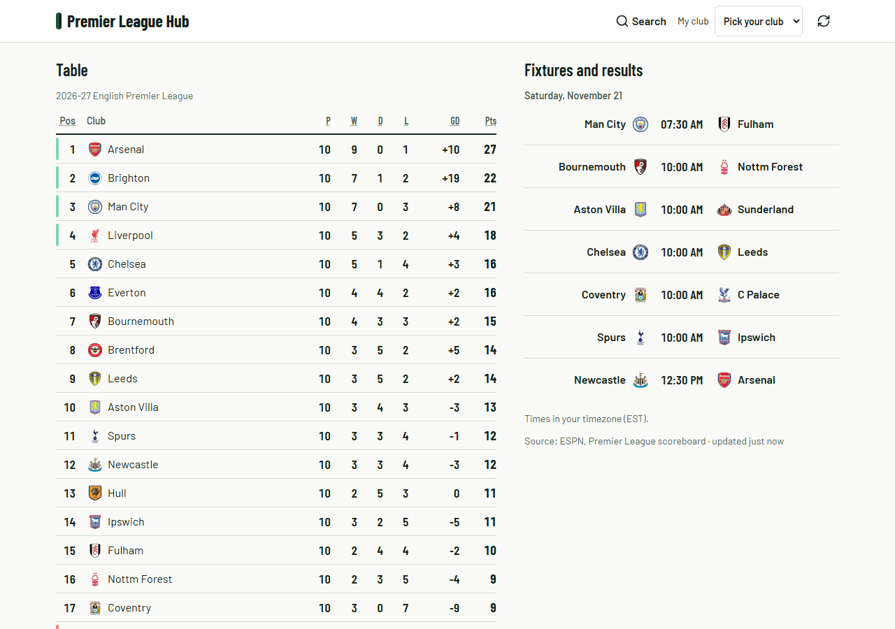
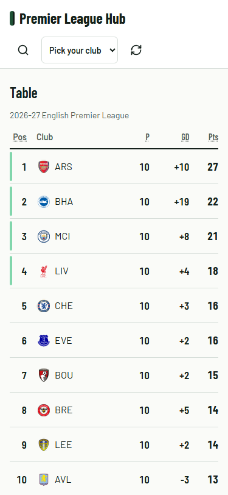
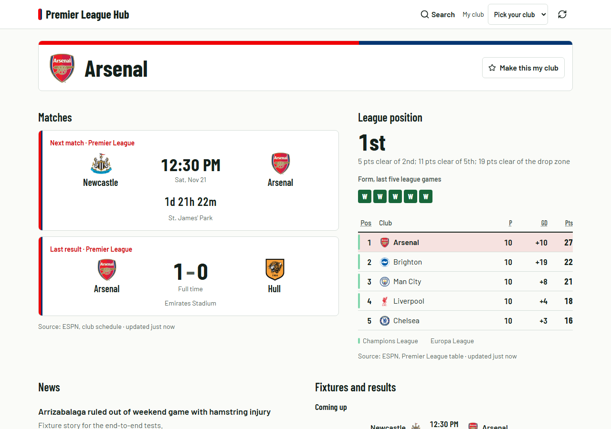
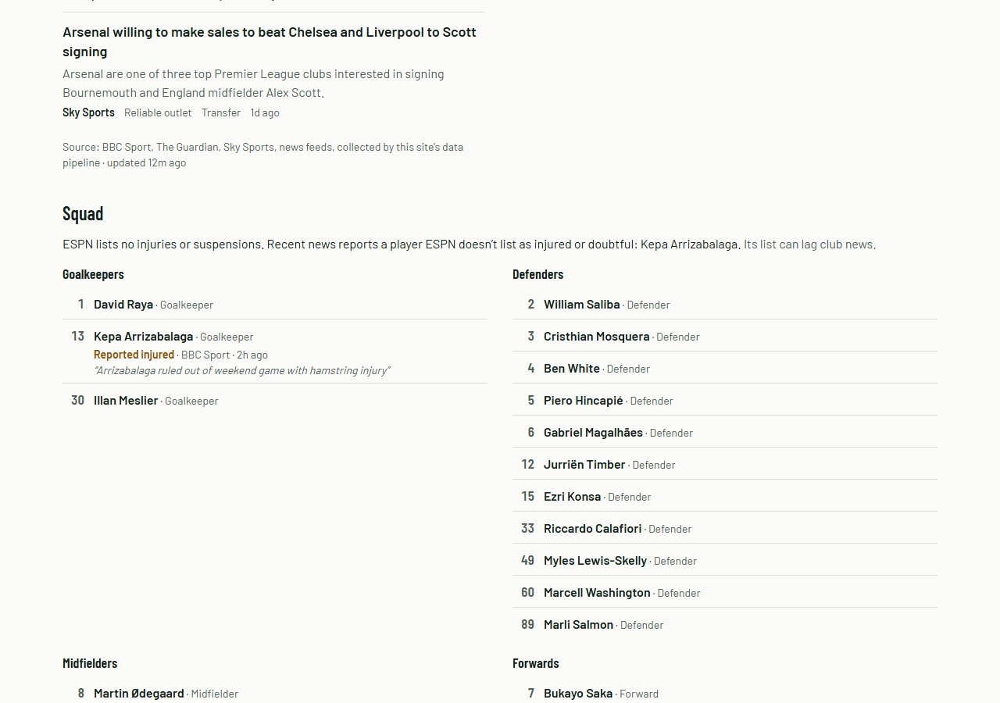
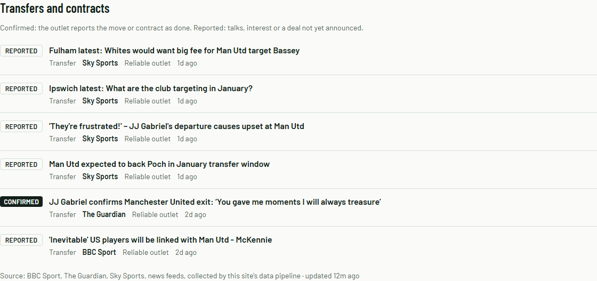
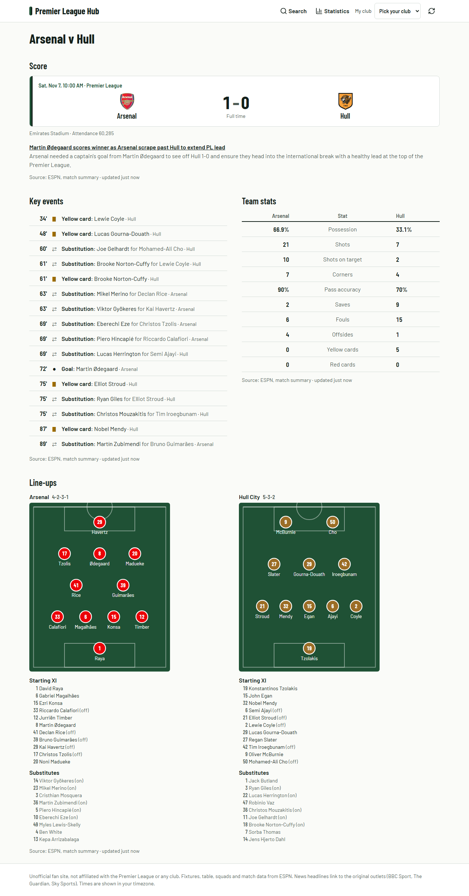

# Premier League Hub

An unofficial fan site for all 20 Premier League clubs: live table, fixtures and results in your timezone, club pages,
squads with injury reports, a match centre, news with source credibility, a transfer and contract feed, search, and a
"my club" theme. Successor to [Arsenal Hub](https://github.com/mushahidur-lgtm/arsenal-hub).

Live: **https://mushahidur.gitlab.io/premier-league-hub/** · Source: [GitLab](https://gitlab.com/mushahidur/premier-league-hub)
(main) and a [GitHub mirror](https://github.com/mushahidur-lgtm/premier-league-hub).

## Screenshots

Taken by Playwright from the production build (`npm run screenshots`) with the recorded e2e fixtures. Club crests are
live from ESPN's CDN. The injury story in the squad shot is the made-up fixture story the e2e tests use for rule 3.

| League home (desktop)                            | League home (375 px)                                            |
| ------------------------------------------------ | --------------------------------------------------------------- |
|         |      |
| **Club page**                                    | **Squad: a "reported injured" note from the news**              |
|           |  |
| **Transfers and contracts (home)**               | **Match centre**                                                |
|  |                      |

## What's on it

- **League home** (`#/`): table with qualification and relegation zones, the current round of fixtures and results in
  the viewer's timezone, top stories across the league, transfers and contracts, and a "pick your club" grid.
- **Club pages** (`#/club/<slug>`): next match with countdown, last result, table position, gaps and form, club news
  with outlet credibility, squad with availability, fixtures and results.
- **Match centre** (`#/match/<event-id>`): score, key events, team stats, line-ups on a formation pitch.
- **My club**: stored in `localStorage`; the home page leads with it and the UI takes its colour as an accent,
  darkened until it passes WCAG AA.
- **Search** (`#/search?q=`) across clubs, players (all 20 squads) and stories.

## Commands

| Command                       | What it does                                                             |
| ----------------------------- | ------------------------------------------------------------------------ |
| `npm run dev`                 | Dev server                                                               |
| `npm run build`               | Production build to `dist/`                                              |
| `npm run preview`             | Serve the build at `/premier-league-hub/`                                |
| `npm test`                    | Vitest unit tests                                                        |
| `npm run lint`                | ESLint (including React hooks rules)                                     |
| `npm run typecheck`           | TypeScript check of every `// @ts-check` file (no emit)                  |
| `npm run format:check`        | Prettier check (`npm run format` to fix)                                 |
| `npm run e2e`                 | Playwright (Chromium; 1280, 768 and 375 px; axe), local only             |
| `npm run e2e:record`          | Re-record the e2e fixtures from the live APIs                            |
| `npm run screenshots`         | Retake `docs/screenshots/*.png` and the Open Graph image `public/og.png` |
| `node scripts/fetch-data.mjs` | Fetch news feeds and squads into `public/data/`                          |

Before every commit: `npm run lint && npm run typecheck && npm test && npm run build`.

## Data

**Live from the browser:** ESPN's `site.api.espn.com` standings, scoreboard, club schedules, rosters and match
summaries, which all send CORS headers. Requests for the same data are shared, answers are memoised for 30 s, and the
last good copy of each source is kept in `localStorage`, so a failed refresh shows the saved copy marked as stale
rather than an empty page.

**From the pipeline:** `scripts/fetch-data.mjs` (Node 22, no dependencies) fetches each club's BBC Sport, Guardian and
Sky Sports feeds plus three league-wide feeds (57 in all) and the 20 ESPN squads. It parses RSS and Atom,
de-duplicates, tags each story with clubs and players, and writes two same-origin files:

- `data/news.json`: `{ generatedAt, outlets, items[] }`, each item with `id`, `title`, `link`, `date`, `image`,
  `excerpt`, `author`, `outlet`, `clubs` (slugs), `players` (ESPN ids) and `also` (near-identical copies from other
  feeds). Last 14 days, at most 800 items.
- `data/meta.json`: `generatedAt`, `durationMs`, `counts` (`feeds`, `feedsOk`, `rawItems`, `items`, `rostersOk`,
  `players`, `itemsWithPlayers`), and per-source status lists `feeds[]` (`club`, `outlet`, `url`, `ok`, `status`,
  `items`, `error`, `ms`) and `rosters[]` (`club`, `ok`, `players`, `error`).

A failed feed or squad is recorded in `meta.json` and never fails the build; the job fails only if every feed fails,
so an outage can't deploy empty news over good news. Both files are generated in CI and git-ignored.

## CI minutes budget

GitLab Free gives 400 compute minutes a month. The target is under 300, leaving headroom. Playwright never runs in CI.

Measured on 2026-11-19 (Phase 5, after the Phase 4 squad fetches were added):

| Pipeline                       | Jobs           | Measured                          | Budgeted as |
| ------------------------------ | -------------- | --------------------------------- | ----------- |
| Push to `main`                 | `test`+`pages` | 57 s + 39 s (pipeline 3091233441) | 2 min       |
| Scheduled refresh (pages only) | `pages`        | 31 s (pipeline 3091321718)        | 1 min       |

The budget rounds up generously for cache misses, slow runners and feeds that hit the 15 s timeout.

| Schedule          | Runs a month (× 30.4 days) | Scheduled minutes | Left for pushes (of 300) | Pushes that allows |
| ----------------- | -------------------------- | ----------------- | ------------------------ | ------------------ |
| Every 2 hours     | 12 × 30.4 = 365            | 365               | none                     | over budget        |
| Every 3 hours     | 8 × 30.4 = 243             | 243               | 57                       | ~28                |
| **Every 4 hours** | **6 × 30.4 = 183**         | **183**           | **117**                  | **~58**            |
| Every 6 hours     | 4 × 30.4 = 122             | 122               | 178                      | ~89                |

**Choice: every 4 hours** (cron `0 */4 * * *`, America/Toronto: 00:00, 04:00, 08:00, 12:00, 16:00, 20:00). It keeps
news under four hours old and leaves room for about 58 pushes a month. Every job is budgeted at a full minute or more, so
the real use is lower: 183 budgeted scheduled minutes plus, say, 30 pushes × 2 = 60 is about 243 a month.

## Architecture decisions

- **Hash routing** (`#/`, `#/club/<slug>`, `#/match/<id>`, `#/search?q=`), parsed in `src/lib/route.js`, so any route
  survives a refresh on GitLab Pages without a 404 fallback. Every route but home is lazy-loaded; the main chunk is
  about 73 KB gzipped (budget 150 KB).
- **One club config.** Everything club-specific (ESPN id, slug, names, curated colours, aliases, verified feeds) is in
  `src/config/clubs.js`; a unit test fails if any other file in `src/` names a club. ESPN data is matched by
  `espnId`, never by abbreviation.
- **No CORS relays and no `/teams/:id`.** The browser calls only ESPN endpoints that send CORS headers; news comes
  from the pipeline as same-origin JSON. This removes the rate-limit and outage risk of public relays and rss2json
  that Arsenal Hub had.
- **JavaScript with JSDoc and `// @ts-check`** in `src/lib` and `src/config`, not TypeScript, so Arsenal Hub's modules
  and tests ported straight across. Dependency majors match Arsenal Hub (React 18, Vite 6, Tailwind 4), except Vitest, which is on 5 for its
  security fixes.
- **One `useSource(key)` hook per data section**, backed by keyed loaders and a keyed last-good-copy cache. Each
  section renders the same `Section` component, which has loading, empty, stale and error (with Try again) states and
  a "Source · updated …" line. For news, "updated" is the pipeline run, not the browser fetch.
- **Player tagging in the pipeline**, against all 20 squads: a full name tags anywhere; a surname needs the story to
  be tagged with that player's club and must be unique there. Never a bare surname across clubs.
- **Injury consistency (rule 3).** A recent headline from a reliable outlet that names a squad player with injury
  wording shows "Reported injured · outlet · time" on that player, and the squad never says "all fit". ESPN's empty
  list is described as "ESPN lists no injuries or suspensions. Its list can lag club news."
- **Transfers** are a simplified feed: "Confirmed" only for completion wording from a reliable outlet with no hedge,
  otherwise "Reported". Manager news, finances, fan pieces, live blogs and newsletters are left out.
- **Accent colours** are computed (`src/lib/accent.js`): a club's primary colour is darkened until it reaches 4.5:1
  on the page and on its own tint; raw club colours are decoration only. Tested for all 20 clubs.
- **Crests** come from ESPN's CDN resized by its image combiner (`src/lib/crest.js`): about 4 KB per crest instead of
  a 36 KB, 500 px original. No Premier League logo or wordmark anywhere.
- **E2E tests are local only**, against the production build, with every request answered from recorded fixtures
  and the clock pinned to the recording time; axe (WCAG 2.1 AA) on every main route at 1280, 768 and 375 px.
- **Generated data is never committed**, and neither are scratch files, HTTP dumps or anything with IPs or tokens.

The full decision log, including corrections to the original brief, is in [PLAN.md](PLAN.md).

## Disclaimer

Unofficial fan site, not affiliated with the Premier League or any club. Data from ESPN; news links to the original
outlets. MIT licensed (see [LICENSE](LICENSE)).
